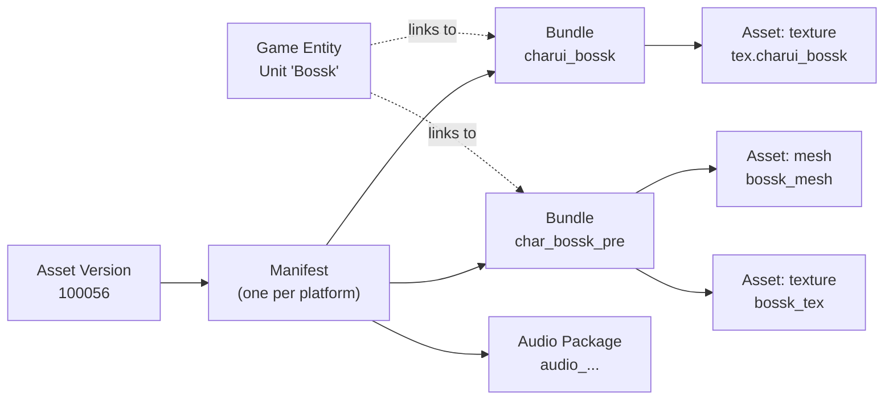

# Concepts

SWGOH does not ship its pictures as loose image files. It downloads
thousands of Unity **bundles**, each holding a handful of **assets**, and
looks them up by name. Knowing a few terms makes every interface easier to
use.

## Asset version

A numbered release of the game's downloadable content, such as `100056`.
It changes whenever the game publishes new or updated assets, which can be
more often than the app itself updates. Every interface uses the latest
version unless you ask for another:

| Interface | Pick a version |
|---|---|
| CLI | `--asset-version 100054` |
| GUI | Type it in **Game data → Asset Version** and press **Load Manifest** |
| HTTP API | `?version=100054` |

`ae3 version` shows the version AE3 would use and where it found it.

## Platform

The game publishes a parallel set of assets for each device family:
**Windows**, **Android** and **iOS**. Bundle names are the same on all
three; the texture encodings inside differ. AE3 decodes all of them to the
same PNGs, so for most uses the default (Windows) is fine.

| Interface | Pick a platform |
|---|---|
| CLI | `--platform android` |
| GUI | **Game data → Platform** |
| HTTP API | `?assetOS=1` (0 Windows, 1 Android, 2 iOS; names work too) |

## Manifest

The list of every package in one asset version for one platform, with its
size and a content hash. Everything else starts from the manifest. AE3
downloads it once per version and keeps it in its cache.

## Package, bundle and audio package

A **package** is one downloadable file in the manifest. It is either:

- a **bundle**: a Unity asset bundle holding assets such as textures,
  sprites, meshes and data, or
- an **audio package**: the game's Wwise sound data.

Bundle names are lowercase and descriptive: `charui_bossk`, `skill_zeta`,
`scavenger_carbonitecicuitboard`. When this documentation says "bundle
name", that is what it means, and it is what every interface takes.

## Category

The part of a bundle's name before the first underscore: `charui` for
`charui_bossk`, `skill` for `skill_zeta`. Categories group bundles by kind
and decide the folder an export goes to. There are close to 300.
Categories you are likely to want:

| Category | What its bundles hold | Example |
|---|---|---|
| `charui` | Character and ship portraits (thumbnails), 128×128 | `charui_bossk` |
| `char` | Character 3D models, textures and animations | `char_bossk_pre` |
| `ship` | Ship 3D models | `ship_executor_pre` |
| `relic` | Each unit's relic image (its signature item) | `relic_rfl_bossk` |
| `ability` | Ability icons and effect bundles | `ability_bossk_basic` |
| `abilityui` | Icons for passive and special abilities | `abilityui_passive_contract` |
| `skill` | Ability material icons (Mk I–III, Omega, Zeta, Omicron) | `skill_zeta` |
| `shipskill` | Ship ability material icons | `shipskill_star` |
| `scavenger` | Relic material icons (Signal Data, Circuit Boards…) | `scavenger_data01` |
| `equip` | Gear icons | `equip_stungun` |
| `vanity` | Player portraits | `vanity_bossk` |
| `crewportrait` | Ship crew portrait models | `crewportrait_bossk_pre` |
| `icon` | Assorted UI icons | |
| `audio` | Audio packages | |

The full list, with counts and sizes, comes from
`ae3 list --categories`.

## Asset

One Unity object inside a bundle: a texture, a sprite atlas, a mesh, a text
file, a data object or (in an audio package) a sound. AE3 sorts assets into
these kinds:

| Kind | What it is | Exported as |
|---|---|---|
| `texture` | An image | PNG or lossless WebP |
| `atlas` | Many small images packed into one texture | One image per sprite, plus a JSON map |
| `sprite` | One image from an atlas, or a standalone sprite | PNG or WebP |
| `mesh` | A 3D model | Wavefront OBJ and/or binary glTF (`.glb`) |
| `text` | A text asset | Its original bytes |
| `structured` | A data object (materials, animation controllers, MonoBehaviours…) | JSON |
| `audio` | A sound in an audio package | Ogg Vorbis, WAV, or raw Wwise |

Single-image bundles usually hold one texture named `tex.` followed by the
bundle name: `charui_bossk` holds `tex.charui_bossk`.

## Path id

The number that identifies an asset inside its bundle, such as
`-6516795281392349143`. Names are not unique (two assets in one bundle can
share a name), but path ids are. They usually stay the same from one asset
version to the next, but a rebuilt bundle can renumber its assets, so look
them up again after a game update rather than hard-coding them. `ae3 search` prints
them; `ae3 extract BUNDLE --path-id ID` exports just that asset; in the GUI,
checking assets in the preview does the same thing.

Path ids are often negative. Pass them as they are:
`--path-id -6516795281392349143`.

## Asset index

A record of the assets (names, kinds, path ids) in every bundle, which AE3
builds by reading only the first part of each bundle. It is what lets
`ae3 search` find "bossk_tex" inside `char_bossk_pre`.

- The first build for a platform takes a minute or two.
- Later builds only re-read bundles that changed in a new asset version.
- The CLI updates it automatically before each search (unless you pass
  `--names-only` or `--no-update`); `ae3 index` updates it on its own.
- The GUI builds it in the background as soon as a manifest is loaded, with
  **Pause** and **Resume** in the sidebar.

## Game entity and name index { #game-entity }

A **game entity** is something players know by a display name: a
**unit** (character or ship), **ability**, **gear** piece, **material** or
**player portrait**. Each has a gamedata id (`BOSSK`,
`ability_mat_E`) and links to the bundles that hold its pictures and
models.

The **name index** holds every game entity's display name in one language,
with its linked bundles. AE3 builds it from the community
[gamedata mirror](https://github.com/swgoh-utils/gamedata), rebuilding only
when the game data changes, and keeps about 0.5 MB of it in the cache. If
GitHub is unreachable, AE3 uses the last copy it built.

How an entity's bundles are found: the game data refers to images and
models by names such as `tex.charui_bossk` or `unit.char_bossk_pre`. With
the prefix (`tex.`, `unit.`, `prefab.`, `ui.`) removed, those are bundle
names. For each kind, AE3 reads these fields:

| Entity kind | Bundles it links to, in order |
|---|---|
| Unit | Portrait (`charui_…`), model (`char_…_pre` / `ship_…_pre`), relic image (`relic_…`), era portrait, battle portrait model and texture, turn-order portrait |
| Ability | Ability icon, ability effect bundle |
| Gear | Gear icon (`equip_…`) |
| Material | Material icon (`skill_…`, `scavenger_…`, …) |
| Player portrait | Portrait icon (`vanity_…`) |

A link can name a bundle that the current manifest doesn't have; AE3 shows
that entity with no bundle rather than hiding it.

!!! tip "Unit shards"
    Unit shards are materials in the game data, but they link to their
    unit; search for the unit instead.

## Atlas and atlas cutting

A sprite **atlas** packs many small images (sprites) into one texture and
records where each one sits. **Atlas cutting**, on by default, writes each
sprite as its own file named after the sprite, plus a JSON file describing
the atlas. Many bundles carry a copy of an atlas whose texture lives in one
shared bundle; AE3 cuts those sprites once, into the shared bundle's folder.

NGUI, the UI system the game uses, trims transparent edges from sprites to
pack them tighter. **Padding restoration**, also on by default, puts that
transparent margin back so each sprite has its original size.

## Diff

The packages added, changed or removed between two asset versions of one
platform. A diff in which 80% or more of the shared bundles changed is
flagged as an **engine rebuild**: the game moved to a new Unity version,
and most "changes" are re-encodings rather than new art.

## Cache

Downloaded bundles, manifests, the asset index and the name index are kept
in a cache folder (5 GB by default, least recently used dropped first), so
a bundle unchanged between releases is downloaded once. `ae3 cache` shows
where it is and what it holds. See [Configuration](reference/configuration.md#cache).
