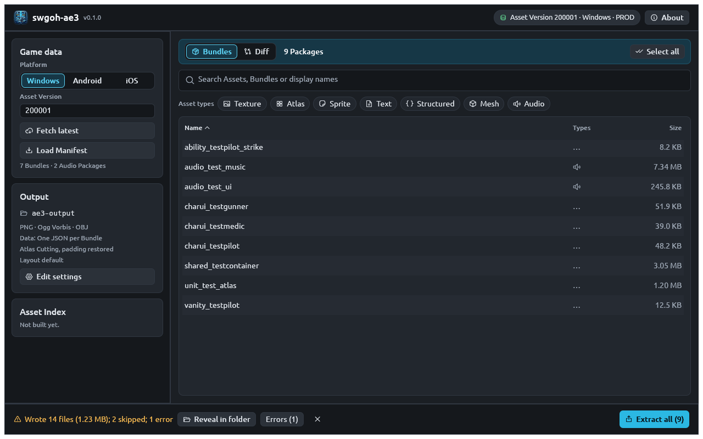

# Extract assets

Extraction downloads the packages you pick (or reuses them from the
[cache](../concepts.md#cache)), decodes their assets and writes them as
ordinary files: PNG or WebP images, OBJ or glTF models, Ogg or WAV sounds
and JSON data.

## Choose what to extract

| You want | CLI | GUI | HTTP API |
|---|---|---|---|
| One or more bundles | `ae3 extract charui_bossk skill_zeta` | Select rows → **Extract selected (N)** | `/Asset/single?assetName=charui_bossk` (main texture only) |
| One asset from a bundle | `ae3 extract char_bossk_pre --path-id 719922364503921676` | Check it in the preview → **Extract 1 Asset** | — |
| A whole category | `ae3 extract --category charui` | Search `charui_` → **Extract all (N)** | List with `/Asset/list`, fetch each |
| Every bundle | `ae3 extract --all` | Clear the search → **Extract all (N)** | — |
| Every audio package | `ae3 extract --audio` | Filter **Audio** → **Extract all (N)** | — |
| Some sounds of one audio package | `ae3 extract audio_evt_darthmalak --sound 117895005` | Check sounds in the preview → **Extract N Sounds** | — |
| What changed since a version | `ae3 diff 100054 --extract all` | **Diff** tab → **Extract all (N)** | `/Asset/listDiff`, then fetch each |

## Extract whole bundles

=== "CLI"

    Name as many bundles (or audio packages) as you like:

    ```bash
    ae3 extract charui_bossk skill_zeta scavenger_carbonitecicuitboard relic_rfl_bossk
    ```

    ```text
    Exporting 4 Packages to ae3-output
    Wrote 4 files (124.1 KB) from 4 of 4 Packages to ae3-output
    ```

    ```text
    ae3-output/
    ├── charui/charui_bossk/tex.charui_bossk.png
    ├── relic/relic_rfl_bossk/tex.relic_rfl_bossk.png
    ├── scavenger/scavenger_carbonitecicuitboard/tex.scavenger_carbonitecicuitboard.png
    └── skill/skill_zeta/tex.skill_zeta.png
    ```

    A model bundle writes more: textures, meshes and one JSON file of data
    objects.

    ```bash
    ae3 extract char_bossk_pre
    ```

    ```text
    ae3-output/char/char_bossk_pre/
    ├── Bossk_weapon.obj
    ├── bossk_mask.png
    ├── bossk_mesh.obj
    ├── bossk_tex.png
    ├── char_bossk_pre.structured.json
    ├── grad_line_vertical_03_tex.png
    ├── rfl_bossk_tex.png
    ├── vfx_net_gun_01.obj
    └── vfx_windlines_01.png
    ```

=== "GUI"

    1. Click a bundle in the table; Ctrl-click (⌘-click on macOS) or
       Shift-click to select several. **Select all** selects every row the
       table shows.
    2. Press **Extract selected (N)** in the action bar at the bottom.

    The action bar always offers the most specific extraction first:

    | State | Primary button |
    |---|---|
    | Assets are checked in the preview | **Extract N Assets** (or **Sounds**) |
    | Rows are selected | **Extract selected (N)** |
    | Nothing selected | **Extract all (N)**: every package the table shows |

    While it runs, the bar shows progress and a **Cancel** button. When it
    finishes, it shows a summary, **Reveal in folder**, and an
    **Errors (N)** menu if anything failed.

    

=== "HTTP API"

    `/Asset/single` returns one bundle's main texture as PNG: the
    `Texture2D` named `tex.{bundle}`, or else the bundle's first
    `Texture2D`. That covers single-image bundles such as `charui_*`,
    `skill_*`, `scavenger_*`, `equip_*`, `relic_*` and `vanity_*`.

    ```bash
    curl -s -o tex.skill_zeta.png "http://127.0.0.1:8080/Asset/single?assetName=skill_zeta"
    ```

    The response has `Content-Type: image/png` and
    `Content-Disposition: inline; filename="tex.skill_zeta.png"`, so
    `curl -OJ` saves it under that name:

    ```bash
    curl -s -OJ "http://127.0.0.1:8080/Asset/single?assetName=skill_zeta"
    ```

    For meshes, atlases, sounds or data, use the CLI or GUI.

## Extract one asset by path id

Big bundles hold many assets. To export just one, find its path id
([Locate assets](locate-assets.md)) and pass it:

=== "CLI"

    ```bash
    ae3 extract char_bossk_pre --path-id 719922364503921676
    ```

    ```text
    Exporting 1 Package to ae3-output
    Wrote 1 file (114.7 KB) from 1 of 1 Package to ae3-output
    ```

    Repeat `--path-id` for several assets of the same bundle. Negative ids
    work as they are:

    ```bash
    ae3 extract char_bossk_pre --path-id 719922364503921676 --path-id -3565641646980641963
    ```

    `--path-id` needs exactly one bundle. Assets picked this way are always
    written as their own files, including data objects and scene objects
    such as Transforms, which a whole-bundle export leaves out.

=== "GUI"

    1. Click the bundle to open its preview.
    2. Tick the checkbox in the corner of each asset you want, or use
       **Check all** / **Uncheck all**.
    3. Press **Extract N Assets**.

    

=== "HTTP API"

    Not supported. The API returns only a bundle's main texture.

## Extract sounds

Audio packages hold Wwise sounds, written as `{wwise id}.ogg` by default
(PCM and PTADPCM sounds become `.wav`):

```bash
ae3 extract audio_evt_darthmalak
```

```text
ae3-output/audio/audio_evt_darthmalak/
├── 117895005.ogg
├── 170426369.ogg
└── …
```

Export only some with `--sound ID` (repeatable, one audio package). In the
GUI, the preview of an audio package lists each sound with its codec,
channels, sample rate, duration and a **Play** button; tick sounds and press
**Extract N Sounds**.


`--audio-format raw` keeps the original Wwise data (`.wem`) instead.

## Extract a whole category, or everything

```bash
ae3 extract --category charui
```

```bash
ae3 extract --all
```

```bash
ae3 extract --audio
```

`--all` means every *bundle* (about 1.3 GB of downloads per platform);
`--audio` means every audio package. A batch keeps going when one package
or asset fails, lists the failures on stderr, and exits with code `3`.
Press ++ctrl+c++ to stop cleanly, keeping what is already written; press it
again to quit at once.

Speed it up or slow it down with `--parallel N` (packages downloaded and
exported at once, default 8). Re-running with `--skip-existing` leaves files
that already exist alone, which makes an interrupted `--all` cheap to
resume:

```bash
ae3 extract --all --skip-existing
```

## Formats and options

Every option below also has a [configuration-file](../reference/configuration.md)
key and an **Edit settings** control in the GUI, so you can set it once.

| CLI option | Values (default first) | What it changes |
|---|---|---|
| `-o`, `--output DIR` | `ae3-output` | Where files go |
| `--layout` | `ae3`, `ae2` | `{output}/{category}/{bundle}/` or swgoh-ae2's `{output}/{category}/` |
| `--image-format` | `png`, `webp` | Textures and sprites; WebP is lossless |
| `--no-atlas-cutting` | | Write atlases as JSON instead of one image per sprite |
| `--no-padding-restoration` | | Keep sprites trimmed instead of restoring their transparent margin |
| `--mesh-format` | `obj`, `glb`, `both` | 3D models; `.glb` embeds the main texture |
| `--audio-format` | `ogg`, `raw` | Sounds |
| `--structured` | `combined`, `separate`, `none` | Data objects: one JSON per bundle, one per asset, or none |
| `--skip-existing` / `--overwrite` | overwrite | Whether to replace files that exist |

Each `--no-…` flag has a positive twin (`--atlas-cutting`,
`--padding-restoration`) to override a configuration file. The
[Output files](../reference/output-files.md) reference describes exactly
what each option writes.


## Pick the asset version and platform

```bash
ae3 extract charui_bossk --asset-version 100054 --platform ios
```

In the GUI, choose **Platform** and type the **Asset Version** in the
sidebar, then press **Load Manifest**. Over HTTP, add `&version=100054&assetOS=2`.

## Next

- [Unit thumbnails](unit-thumbnails.md) and
  [ability and relic materials](upgrade-materials.md) put these pieces
  together for common jobs.
- [Scripting and automation](scripting.md) covers `--json` output and exit
  codes.
