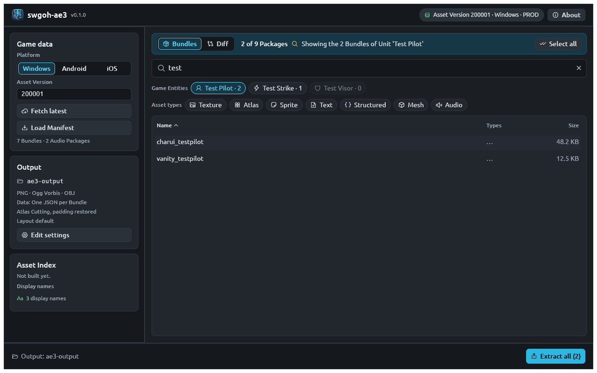

# Identify assets from game data

The game data knows things by the names players see: "Bossk", "Ability
Material Zeta", "Carbonite Circuit Board". The asset files are named
differently: `charui_bossk`, `skill_zeta`, `scavenger_carbonitecicuitboard`.
AE3's **display-name search** bridges the two, using the community game
data to link each [game entity](../concepts.md#game-entity) to its bundles.

## Search by display name

=== "CLI"

    ```bash
    ae3 search "carbonite circuit board" --names-only
    ```

    ```text
    Game Entities
      Material  Carbonite Circuit Board: scavenger_carbonitecicuitboard
      Material  Carbonite Circuit Board Surplus: scavenger_carbonitecicuitboard
    ```

    Each line is `Kind  Display name (context): bundle, bundle, …`. The
    bundles are listed most specific first.

    Matching is case-insensitive and finds the text anywhere in the name, so
    `zeta`, `Zeta` and `ability material zeta` all work. Results are ranked
    with exact matches first.

=== "GUI"

    Load a manifest (**Game data → Fetch latest**), then type in the search
    box. Matching game entities appear as chips under **Game Entities**,
    each with an icon for its kind and the number of linked bundles:

    

    - **Hover** a chip to see its kind, gamedata id and every linked bundle.
    - **Click** a chip to show only its bundles in the table; click it again
      to go back to every match.
    - A greyed-out chip (count 0) has no linked bundle in this manifest.
    - Eight chips show at first; press **N more…** to see up to 200.

    The sidebar's **Asset Index → Display names** line shows how many names
    are loaded. They load in the background when the window opens, from the
    cached copy first.

=== "HTTP API"

    The HTTP API has no display-name search. Look the bundle name up once
    with `ae3 search` (or the GUI), then request it by name:

    ```bash
    curl -s -o circuit_board.png \
      "http://127.0.0.1:8080/Asset/single?assetName=scavenger_carbonitecicuitboard"
    ```

### What the search covers

| Kind | Examples of what you can type | Bundles you get |
|---|---|---|
| Unit | `bossk`, `executor`, `jedi master kenobi` | Portrait, model, relic image, era and turn-order portraits |
| Ability | `bossk's payout`, `hunting party` | Ability icon, ability effect bundle |
| Gear | `stun gun`, `carbanti` | Gear icon |
| Material | `zeta`, `omicron`, `signal data`, `zinbiddle` | Material icon |
| Player portrait | `bossk` | Portrait icon |

An ability is shown with the unit it belongs to in brackets,
`Bossk's Payout (Bossk)`, so same-named abilities can be told apart.

## Read the results as JSON

`--json` gives each entity's kind, gamedata id and bundles, ready for a
script:

```bash
ae3 search "ability material zeta" --json
```

```json
{
  "asset_version": 100056,
  "platform": "Windows",
  "names_only": false,
  "name_index": {
    "status": "current",
    "language": "ENG_US",
    "gamedata_version": "0.40.6:W8EftHi2TSizGnD-1QzTFg",
    "localization_version": "NBtg8ikGTz-rnCFHrdUd8A"
  },
  "query": "ability material zeta",
  "entities": [
    {
      "kind": "material",
      "id": "ability_mat_E",
      "name": "Ability Material Zeta",
      "rank": "exact",
      "bundles": ["skill_zeta"]
    }
  ],
  "hits": [],
  "coverage": {
    "indexed_bundles": 11501,
    "failed_bundles": 0,
    "total_bundles": 11501,
    "audio_packages": 153,
    "other_packages": 0
  }
}
```

| Field | Meaning |
|---|---|
| `entities[].kind` | `unit`, `ability`, `gear`, `material` or `player-portrait` |
| `entities[].id` | The gamedata id: `BOSSK`, `ability_mat_E`, … |
| `entities[].context` | For an ability, its unit's display name (absent otherwise) |
| `entities[].rank` | How well the name matched; exact matches come first |
| `entities[].bundles` | Linked bundles present in this manifest, most specific first |
| `name_index.status` | `current`, `built` (just rebuilt), `unchecked` (`--no-update`), `stale` (couldn't update; using the cached copy) or `unavailable` |
| `hits` | Bundle and asset matches; see [Locate assets](locate-assets.md) |

Pull just the bundle names out with `jq` (bash) or PowerShell:

=== "bash"

    ```bash
    ae3 search bossk --names-only --json \
      | jq -r '.entities[] | select(.kind == "unit") | .bundles[0]'
    ```

=== "PowerShell"

    ```powershell
    (ae3 search bossk --names-only --json | ConvertFrom-Json).entities |
      Where-Object kind -eq 'unit' |
      ForEach-Object { $_.bundles[0] }
    ```

Both print `charui_bossk`.

## Search in another language

Display names exist in every language the game supports. Search in one
with `--language`, by code or name:

```bash
ae3 search "Pièce" --language french --names-only
```

```text
Updating the Name Index (FRE_FR, gamedata 0.40.6:W8EftHi2TSizGnD-1QzTFg)
Game Entities
  Ability  Pièces de rechange (50R-T): abilityui_leader_spareparts, ability_char_buff_ldr
```

| Code | Also accepted |
|---|---|
| `ENG_US` (default) | `en`, `english` |
| `FRE_FR` | `fr`, `french` |
| `GER_DE` | `de`, `german` |
| `ITA_IT` | `it`, `italian` |
| `SPA_XM` | `es`, `spanish` |
| `POR_BR` | `pt`, `portuguese` |
| `RUS_RU` | `ru`, `russian` |
| `TUR_TR` | `tr`, `turkish` |
| `JPN_JP` | `ja`, `japanese` |
| `KOR_KR` | `ko`, `korean` |
| `CHS_CN` | `zh-hans`, `chinese-simplified` |
| `CHT_CN` | `zh-hant`, `chinese-traditional` |
| `IND_ID` | `id`, `indonesian` |
| `THA_TH` | `th`, `thai` |

To change the default for the CLI **and** the GUI, set `language` in the
[configuration file](../reference/configuration.md) or the `AE3_LANGUAGE`
environment variable. The GUI has no language picker of its own; it uses
this setting. Each language's name index is built once (about 25 MB of
downloads) and cached.

## When a name isn't found

- **Search a shorter piece of the name.** `signal data` finds all four
  Signal Data tiers; `circuit` finds the Carbonite Circuit Board.
- **Check the name index is up to date.** A brand-new unit appears once the
  community gamedata mirror publishes the update. A warning such as
  `could not update the Name Index (…); using the cached one` means AE3
  could not reach GitHub.
- **Fall back to bundle and asset names.** Without `--names-only`, the same
  search also matches bundle names and the asset names inside bundles,
  which often contain the unit's internal name (`bossk`, `glmandogrogu`).
  See [Locate assets in bundles](locate-assets.md).

## Advanced: read the game data yourself

The links AE3 uses come from public files in the
[gamedata mirror](https://github.com/swgoh-utils/gamedata). If you need a
field AE3 doesn't index, read them directly. Strip the `tex.`, `unit.`,
`prefab.` or `ui.` prefix from a reference and lowercase it to get a bundle
name.

| File | Field | Example value | Bundle |
|---|---|---|---|
| `units.json.br` | `thumbnailName` | `tex.charui_bossk` | `charui_bossk` |
| `units.json.br` | `unitPrefab` | `unit.char_bossk_pre` | `char_bossk_pre` |
| `units.json.br` | `relicDefinition.texture` | `tex.relic_rfl_bossk` | `relic_rfl_bossk` |
| `ability.json` | `icon` | `tex.abilityui_passive_contract` | `abilityui_passive_contract` |
| `material.json` | `iconKey` | `tex.skill_zeta` | `skill_zeta` |
| `equipment.json` | `iconKey` | `tex.equip_stungun` | `equip_stungun` |
| `playerPortrait.json` | `icon` | `tex.vanity_bossk` | `vanity_bossk` |

Display names live in the localization file (`Loc_ENG_US.txt.json.br`),
under each row's `nameKey`.
