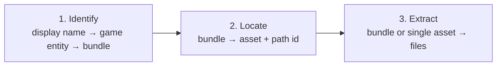

# Guides

Task-focused walkthroughs. Each shows the command line, the desktop GUI and
the HTTP API side by side, in tabs; the tab you choose is remembered across
pages.

Most tasks follow the same three steps:

| Guide | Use it when you want to… |
|---|---|
| [Identify assets from game data](identify-assets.md) | Go from a name players see ("Bossk", "Zeta") to bundle names |
| [Locate assets in bundles](locate-assets.md) | Browse categories, search asset names, get path ids |
| [Extract assets](extract-assets.md) | Export bundles, categories, single assets, or everything |
| [Unit thumbnails](unit-thumbnails.md) | Get character and ship portraits, one or all |
| [Ability and relic materials](upgrade-materials.md) | Get icons for ability materials, relic materials and gear |
| [Track new assets](track-new-assets.md) | See and export what a game update added or changed |
| [Scripting and automation](scripting.md) | Drive AE3 from bash, PowerShell, Python or JavaScript |

!!! info "About the HTTP API tabs"
    The HTTP API is swgoh-ae2's protocol: it lists bundle names, diffs
    versions and returns a bundle's main texture as PNG. It does not search
    display names or asset indexes, or export meshes, sounds and data. Where
    a task needs those, the HTTP API tab says so and shows the closest
    alternative.
