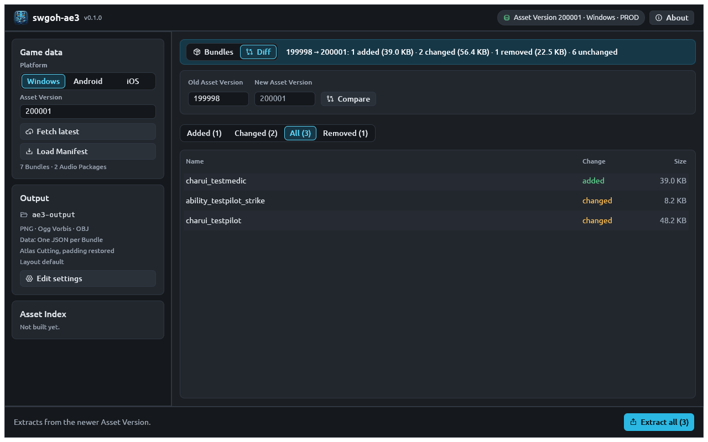

# Track new assets between releases

Each game update publishes a new [asset version](../concepts.md#asset-version).
A **diff** compares two versions and lists the packages that were added,
changed or removed, so you can export only what's new: the portrait and
ability icons of a newly released unit, for example.

## See what changed

=== "CLI"

    Compare an older version with the latest:

    ```bash
    ae3 diff 100054
    ```

    ```text
    Diff 100054 -> 100056 (Windows)
      added        50 Packages     9.9 MB
      changed      50 Packages   119.2 MB
      removed       0 Packages
      42 of 11454 Bundles in both changed (0.4%)

    Added:
      + ability_char_droid_explode_glmandogrogu_granted_01 (115.4 KB)
      ...
      + ability_glmandogrogu_basic (8.0 KB)
      ...
    ```

    Give both versions to compare two older ones: `ae3 diff 100052 100054`.
    `--summary` prints only the counts.

    **Narrow to one category** to see, for example, which new portraits
    arrived:

    ```bash
    ae3 diff 100054 --category charui
    ```

    ```text
    Diff 100054 -> 100056 (Windows, Category charui)
      added         2 Packages    31.6 KB
      changed       0 Packages        0 B
      removed       0 Packages
      0 of 773 charui Bundles in both changed (0.0%)

    Added:
      + charui_glmandogrogu (6.9 KB)
      + charui_large_glmandogrogu (24.8 KB)
    ```

    The update added The Mandalorian and Grogu.

=== "GUI"

    1. Load the newer version (**Fetch latest**).
    2. Switch the banner from **Bundles** to **Diff**.
    3. Enter the **Old Asset Version** and press **Compare**.

    

    The banner sums up the diff. **Added**, **Changed**, **All** and
    **Removed** filter the list; **All** means added and changed.

    When a newer asset version is published while the window is open, the
    **Game data** card offers to load it.

=== "HTTP API"

    `/Asset/listDiff` returns the bundle names as a JSON array.
    `diffVersion` is the older version; `version` (default: the latest)
    the newer.

    ```bash
    curl -s "http://127.0.0.1:8080/Asset/listDiff?diffVersion=100054&prefix=charui"
    ```

    ```json
    ["charui_glmandogrogu","charui_large_glmandogrogu"]
    ```

    | `diffType` | Returns |
    |---|---|
    | `0` or `All` (default) | Added and changed |
    | `1` or `New` | Added only |
    | `2` or `Changed` | Changed only |

    Removed bundles are never listed: they no longer exist to fetch.

## Export only what's new

=== "CLI"

    ```bash
    ae3 diff 100054 --extract added
    ```

    `--extract` takes `added`, `changed` or `all` (both), and combines with
    `--category` and every [export option](extract-assets.md#formats-and-options):

    ```bash
    ae3 diff 100054 --category charui --extract added -o new-portraits
    ```

    Files come from the newer version.

=== "GUI"

    On the **Diff** tab, pick **Added**, **Changed** or **All**, optionally
    select rows, and press **Extract all (N)** or **Extract selected (N)**.
    The hover text on **Extract all** shows the download size. Removed
    packages can't be extracted; they exist only in the older version.

=== "HTTP API"

    Fetch each name from `/Asset/listDiff`:

    ```bash
    curl -s "http://127.0.0.1:8080/Asset/listDiff?diffVersion=100054&diffType=1&prefix=charui" \
      | jq -r '.[]' \
      | while read -r name; do
          curl -s -OJ "http://127.0.0.1:8080/Asset/single?assetName=$name"
        done
    ```

## Engine rebuilds

Now and then the game moves to a new Unity version and re-publishes nearly
every bundle. AE3 flags a diff in which at least 80% of the bundles present
in both versions changed as an **engine rebuild** (`"engine_rebuild": true`
in `--json` output, and a note in the text output). After an engine rebuild,
"changed" mostly means "re-encoded"; `--extract added` is usually what you
want.

## Automate it

A scheduled job that exports new portraits and material icons after every
update:

=== "bash"

    ```bash title="new-assets.sh"
    #!/usr/bin/env bash
    set -euo pipefail
    state=last-version.txt
    latest=$(ae3 version --json | jq -r .asset_version)
    last=$(cat "$state" 2>/dev/null || echo "$latest")
    if [ "$latest" != "$last" ]; then
      for category in charui skill scavenger equip; do
        ae3 diff "$last" "$latest" --category "$category" --extract added -o "new/$latest" -q || [ $? -eq 3 ]
      done
    fi
    echo "$latest" > "$state"
    ```

=== "PowerShell"

    ```powershell title="new-assets.ps1"
    $state = 'last-version.txt'
    $latest = (ae3 version --json | ConvertFrom-Json).asset_version
    $last = if (Test-Path $state) { Get-Content $state } else { $latest }
    if ("$latest" -ne "$last") {
      foreach ($category in 'charui', 'skill', 'scavenger', 'equip') {
        ae3 diff $last $latest --category $category --extract added -o "new/$latest" -q
        if ($LASTEXITCODE -notin 0, 3) { exit $LASTEXITCODE }
      }
    }
    Set-Content $state $latest
    ```

Exit code `3` means some packages failed while the rest were exported; the
scripts accept it and carry on. See [Scripting](scripting.md#exit-codes).

## Diff output as JSON

```bash
ae3 diff 100054 --json
```

```json
{
  "old_version": 100054,
  "new_version": 100056,
  "platform": "Windows",
  "engine_rebuild": false,
  "changed_ratio": 0.003666841278156103,
  "shared": 11604,
  "shared_bundles": 11454,
  "changed_bundles": 42,
  "sizes": { "added": 9914511, "changed": 119231896, "removed": 0 },
  "added": [
    { "name": "charui_glmandogrogu", "kind": "bundle", "category": "charui",
      "size": 6876, "content_hash": 3246469009138260700 }
  ],
  "changed": [
    { "name": "char_adelphiranger_pre", "kind": "bundle", "category": "char",
      "old_size": 597982, "size": 595826,
      "old_content_hash": 17905014089114525662, "content_hash": 7144605864136611698 }
  ],
  "removed": []
}
```

(The arrays are shortened here.)
