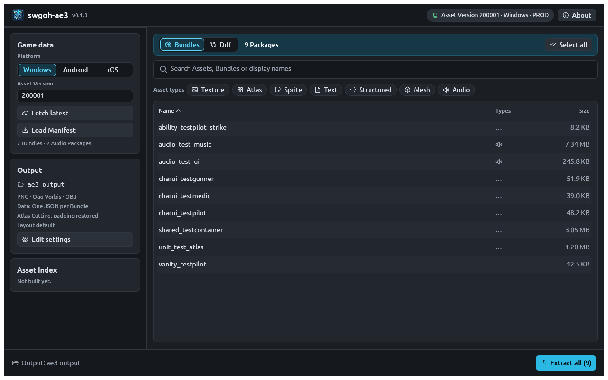
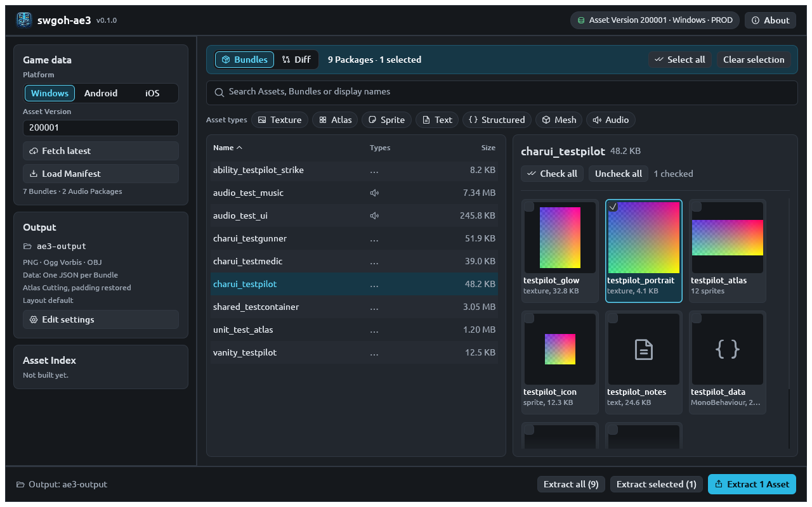
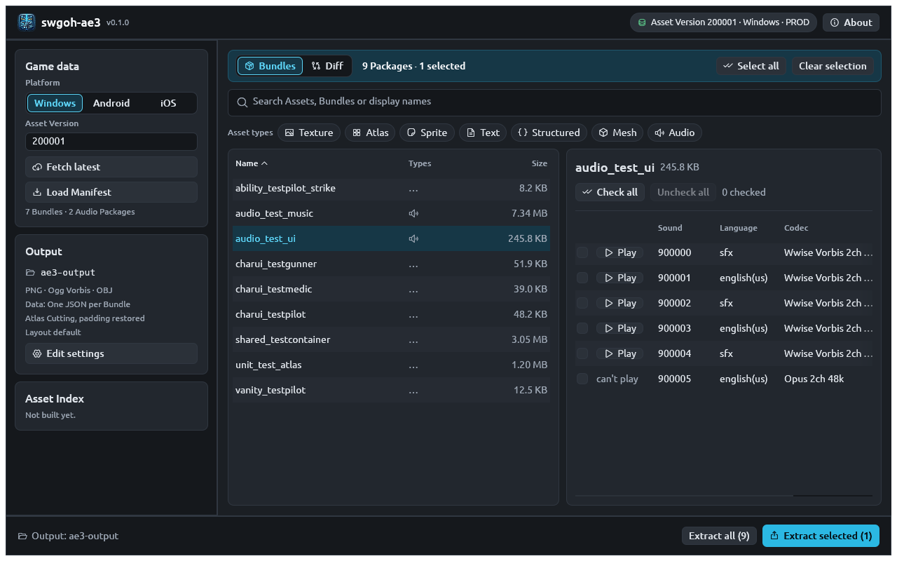
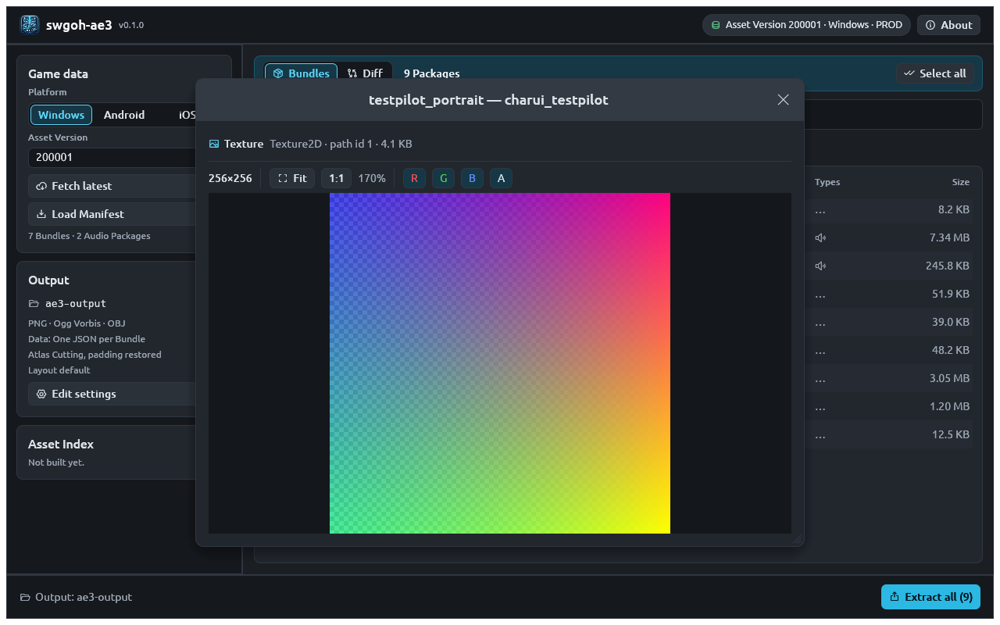
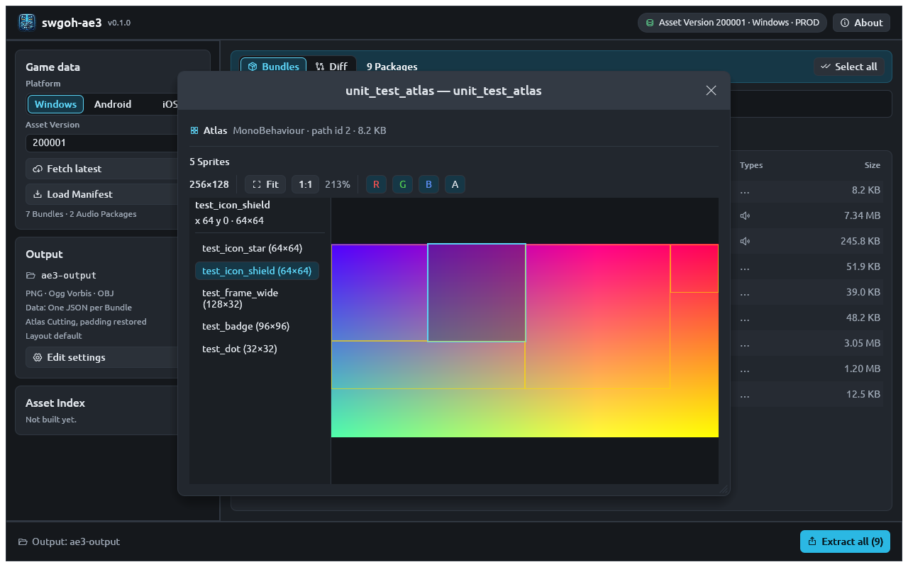
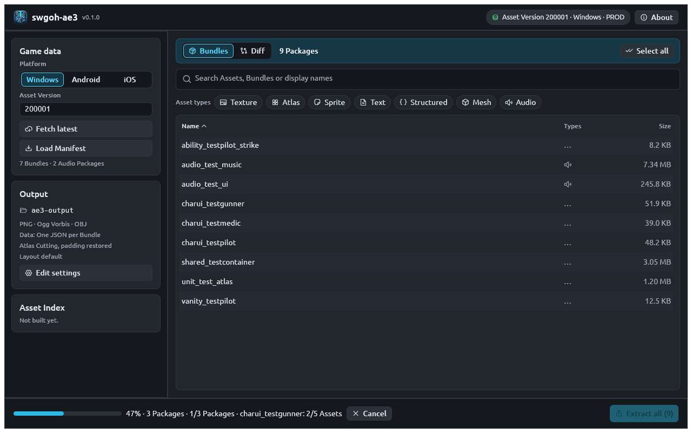
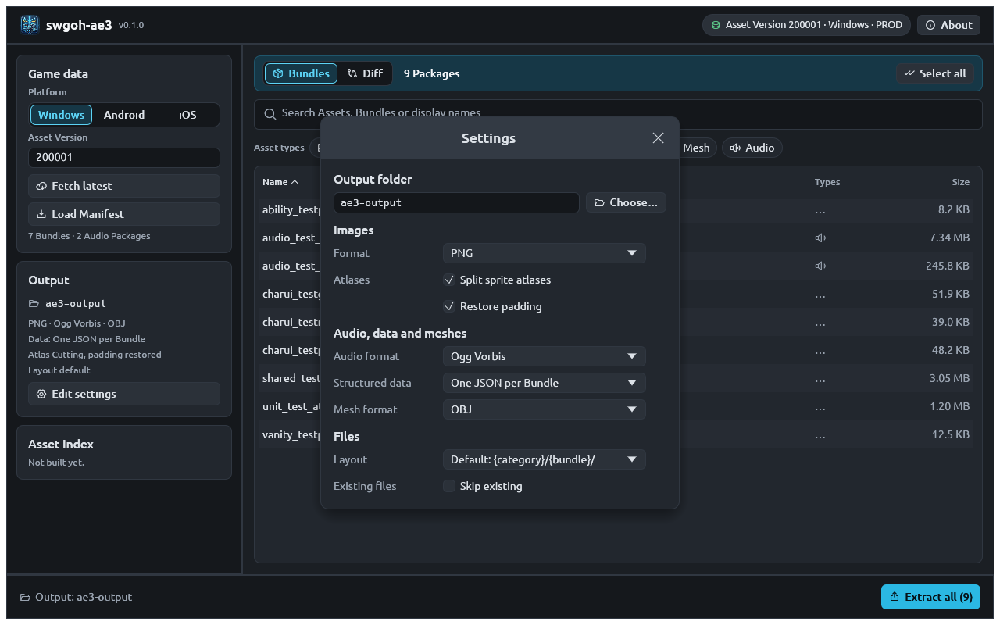

# Desktop GUI reference

The desktop app is `ae3-gui` (`ae3-gui.exe` on Windows, `swgoh-ae3.app` on
macOS). It does everything in one window and follows the system's light or
dark appearance.

*Screenshots on this page come from AE3's automated UI tests, which use
small made-up bundles (`charui_testpilot`, asset version 200001) in place
of real game data. With real data the layout is the same.*

The window has five parts: the **header** across the top, the **sidebar**
on the left, the **banner** and **search** above the main area, the
**table** and **preview**, and the **action bar** along the bottom.

## Header

- **swgoh-ae3** and the running version.
- The asset version shown, as a pill: `Asset Version 100056 · Windows · PROD`.
- **swgoh-ae3 vX available**, when a newer release of AE3 is out (see
  [update checks](configuration.md#update-checks)). It links to the release
  page; the app never downloads or installs anything itself.
- **About**: version, license, and a **Check for updates** button. On
  macOS it is also under **swgoh-ae3 → About swgoh-ae3** in the menu bar.

## Sidebar

Drag the sidebar's edge to resize it.

### Game data

| Control | What it does |
|---|---|
| **Platform** | Windows, Android or iOS |
| **Asset Version** | Leave empty for the latest, or type a version number |
| **Fetch latest** | Find the newest asset version and load its manifest |
| **Load Manifest** | Load the manifest of the version typed (or press ++enter++ in the field) |

Under the buttons: how many bundles and audio packages the manifest has.
When a newer asset version is published while the window is open, this
card offers to load it.

### Output

A summary of where extractions go and in which formats (for example
`PNG · Ogg Vorbis · OBJ`, `Data: One JSON per Bundle`,
`Atlas Cutting, padding restored`, `Layout default`). **Edit settings**
opens the [Settings window](#settings-window).

### Asset Index

Progress of the background [asset index](../concepts.md#asset-index)
build, with **Pause** and **Resume** (progress is kept when paused), how
many bundles it covers, and **Retry** if it failed or some bundles
couldn't be read. Type filters and asset-name search use it; bundle names
and display names match without it.

**Display names** shows how many game-entity names are loaded. They load
in the background when the window opens, from the cached copy first, then
are refreshed from the community game data if it changed. The language is
the `language` setting in the [configuration file](configuration.md).

## Banner and search

The banner switches between the **Bundles** and **Diff** tabs and counts
what is shown: `9 Packages · 1 selected`, or
`2 of 9 Packages · Showing the 2 Bundles of Unit 'Bossk'` while a game
entity is picked. **Select all** selects every row the table shows;
**Clear selection** clears it.

The **search box** matches, case-insensitively:

- bundle and audio package names,
- asset names inside bundles (once the asset index covers them),
- display names of units, abilities, gear, materials and player portraits.

Clear it with the **×** at its right.

### Game Entities

Each chip is one game entity: an icon for its kind, its display name, and
how many linked bundles the manifest has. Hover for its kind, gamedata id
and bundle list. Click to show only its bundles; click again for all
matches. Eight show at first; **N more…** shows up to 200, **Fewer**
collapses them. A greyed chip has no bundle in this manifest.

### Asset types

**Texture**, **Atlas**, **Sprite**, **Text**, **Structured**, **Mesh** and
**Audio** chips show only packages holding at least one asset of the
chosen kinds. **All types** clears them. Bundles not yet indexed have no
known types and are hidden while a type filter is on.

## Table

Columns **Name**, **Types** (icons for the asset kinds inside) and **Size**;
click a heading to sort. Select rows by clicking: ++shift++-click selects
a range, ++ctrl++-click (++cmd++-click on macOS) adds or removes one row.

## Preview

Selecting one bundle shows its assets on the right as a grid of
thumbnails, each with name, kind and size.

- Tick an asset's corner checkbox to include it in **Extract N Assets**.
  **Check all** and **Uncheck all** act on every asset shown.
- **Scene objects (N)** also shows GameObjects, Transforms, MonoScripts and
  the like, hidden by default.
- **Double-click** a thumbnail to open the [detail viewer](#detail-viewer).

An **audio package** shows a list of its sounds instead, with codec,
channels, sample rate and duration, and a **Play** button for each Wwise
Vorbis, PCM or PTADPCM sound (other codecs show "can't play").

## Detail viewer

A window showing one asset at full size, titled `bundle — asset`, with its
kind, Unity class, **path id** and size.

=== "Textures and sprites"

    **Fit** fits the image to the window; **1:1** shows one image pixel
    per screen pixel; the zoom percentage is beside them. **R**, **G**,
    **B** and **A** toggle each colour channel, which helps inspect masks
    and alpha.

    

=== "Atlases"

    Every sprite is outlined on the atlas texture, and listed on the left
    with its size. Select one to highlight it and see its position.

    

=== "Meshes"

    A shaded 3D view: drag to rotate, right-drag to pan, scroll (or pinch)
    to zoom, double-click or **Reset view** to reset.

=== "Text and data"

    Text with syntax highlighting; data objects as a browsable tree.

## Action bar

On the left: the output folder, the running extraction's progress with
**Cancel**, or the last extraction's result with **Reveal in folder** and
**Errors (N)**.

On the right: the extractions available, the most specific highlighted:

| Button | Extracts |
|---|---|
| **Extract N Assets** / **Sounds** | The assets or sounds checked in the preview |
| **Extract selected (N)** | The selected packages |
| **Extract all (N)** | Every package the table shows (after search and filters) |

## Diff tab

Enter an **Old Asset Version** and press **Compare** to compare it with the
loaded (new) version. The banner sums it up; **Added**, **Changed**,
**All** and **Removed** filter the list. **Extract all (N)** and
**Extract selected (N)** export from the newer version (hover for the
download size). Removed packages can't be extracted.

## Settings window

**Edit settings** opens every export option. Changes apply at once and are
saved to the [configuration file](configuration.md) shared with the CLI.

| Setting | Options | Config key |
|---|---|---|
| Output folder | Any folder (**Choose…** to browse) | `output-dir` |
| Images → Format | PNG, WebP (lossless) | `image-format` |
| Images → Split sprite atlases | on/off | `atlas-cutting` |
| Images → Restore padding | on/off | `padding-restoration` |
| Audio format | Ogg Vorbis, Raw (Wwise) | `audio-format` |
| Structured data | One JSON per Bundle, One JSON per Asset, Skip | `structured` |
| Mesh format | OBJ, glb, OBJ + glb | `mesh-format` |
| Layout | Default: `{category}/{bundle}/`, ae2: `{category}/` | `layout` |
| Existing files → Skip existing | on/off | `skip-existing` |

## Common tasks

| Task | Steps |
|---|---|
| Get a unit's portrait | **Fetch latest** → search the unit's name → click its **Unit** chip → select `charui_…` → **Extract selected (1)** |
| Get a material icon | Search `zeta` (or the material's name) → click the chip → **Extract all (1)** |
| Get one texture from a model | Select `char_…_pre` → tick the texture in the preview → **Extract 1 Asset** |
| Export a whole category | Search `charui_` → **Extract all (N)** |
| Export only what an update added | **Diff** → old version → **Compare** → **Added** → **Extract all (N)** |
| Use an older asset version | Type it in **Asset Version** → **Load Manifest** |
